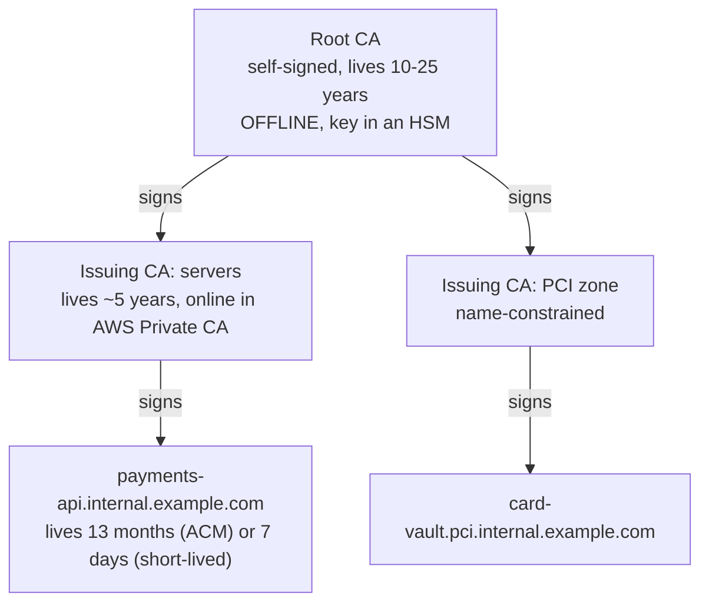
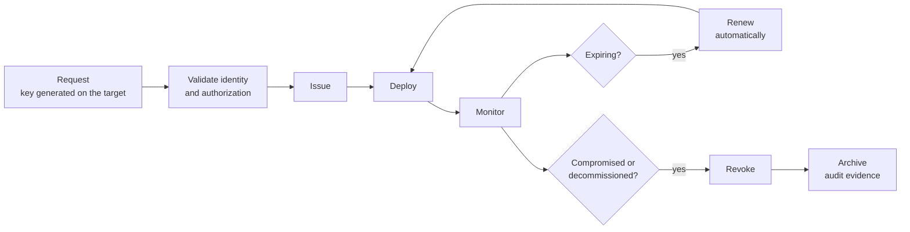
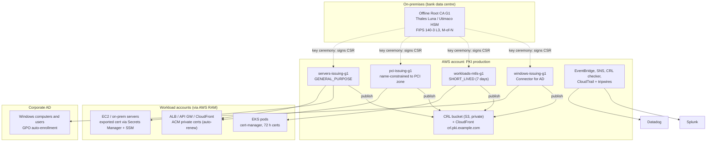
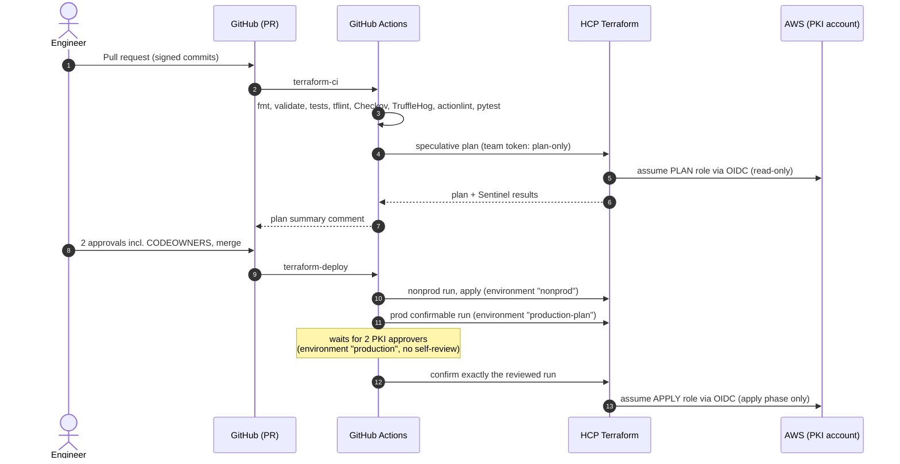
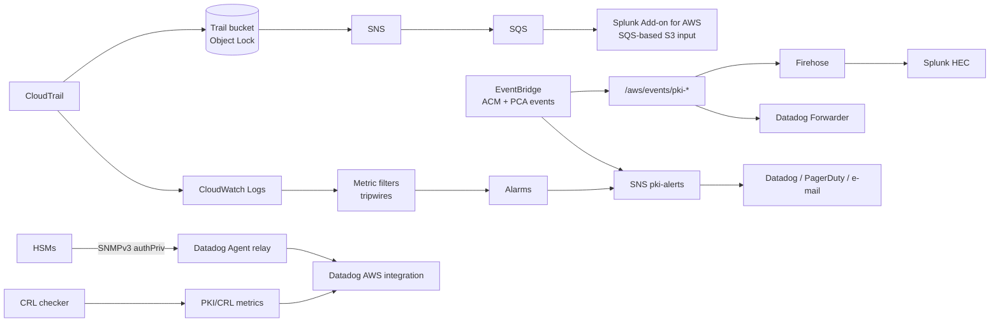

# PKI Platform — AWS Private CA, ACM, HCP Terraform

Infrastructure as Code for an enterprise **Public Key Infrastructure (PKI)** on AWS,
built for a regulated environment (bank, PCI DSS 4.0.1):

- **AWS Private CA** hierarchies (offline HSM root in production, issuing CAs in AWS)
- **AWS Certificate Manager (ACM)** private and public certificates with **automatic renewal**
- a **self-service "vending machine"**: application teams get certificates by adding a few lines of Terraform
- **HCP Terraform** (formerly Terraform Cloud) workspaces driven by **hardened GitHub Actions**
- **observability** with CloudTrail, EventBridge, CloudWatch, **Datadog** (incl. HSM monitoring over **SNMPv3**) and **Splunk**
- **guardrails** at every layer: Sentinel policy as code, SCPs, IAM, Checkov, CODEOWNERS, approvals

> **New to PKI?** Read sections 1 to 4 first (about 20 minutes). They explain what a PKI
> is, what this one looks like, and what you will be doing every week. Everything else
> is reference material you can come back to.

---

## Table of contents

1. [PKI in 15 minutes](#1-pki-in-15-minutes)
2. [Our PKI at a glance](#2-our-pki-at-a-glance)
3. [What a PKI engineer manages here](#3-what-a-pki-engineer-manages-here)
4. [How a change reaches production](#4-how-a-change-reaches-production)
5. [Repository layout](#5-repository-layout)
6. [Module reference](#6-module-reference)
7. [Getting started in VS Code](#7-getting-started-in-vs-code)
8. [Bootstrap from zero](#8-bootstrap-from-zero)
9. [Day-to-day cookbook](#9-day-to-day-cookbook)
10. [Automatic renewal: who renews what](#10-automatic-renewal-who-renews-what)
11. [Observability: Datadog, CloudTrail, Splunk, SNMPv3](#11-observability-datadog-cloudtrail-splunk-snmpv3)
12. [Security model (DevSecOps)](#12-security-model-devsecops)
13. [Compliance mapping (PCI DSS 4.0.1)](#13-compliance-mapping-pci-dss-401)
14. [Pitfalls that hurt](#14-pitfalls-that-hurt)
15. [Runbooks](#15-runbooks)
16. [Assumptions to verify before going live](#16-assumptions-to-verify-before-going-live)
17. [References](#17-references)

---

## 1. PKI in 15 minutes

### 1.1 The problem a PKI solves

Two machines want to talk securely (TLS). Encryption alone is not enough: the client
must be sure it is talking to **the real** `payments-api.internal.example.com` and not
to an attacker. A **certificate** is a signed statement that says *"this public key
belongs to this name, until this date"*. The signer is a **Certificate Authority (CA)**.
If the client trusts the CA, it trusts the statement.

A PKI is everything needed to make that work at scale: CAs, their keys, the policies
saying who can get which certificate, revocation, monitoring and audit.

### 1.2 Key pairs

- Every certificate has a **private key** (secret, stays on the server or in an HSM/ACM)
  and a **public key** (inside the certificate, public).
- What is signed by the private key can be verified by anyone with the public key.
- **If a private key leaks, the certificate must be revoked and replaced.** Protecting
  private keys is the core of the job: in this repository keys are never generated by
  Terraform, never stored in Git, never placed in Terraform state (a Sentinel policy
  enforces it).

### 1.3 The chain of trust



- **Root CA**: the anchor. Its certificate is installed in every **trust store**
  (Windows via GPO, Linux images, Java `cacerts`, mobile devices via MDM). It only signs
  issuing CAs, a few times in its life, during a **key ceremony**. Because replacing it
  means touching every device, it is kept **offline** in a **Hardware Security Module (HSM)**.
- **Issuing (subordinate) CA**: signs end-entity certificates all day long. If one is
  compromised you revoke it at the root and create a new one — painful but survivable.
  We keep **one issuing CA per usage / risk zone** so a problem in one zone does not
  spread.
- **End-entity (leaf) certificate**: what servers, pods, users and devices present.

A client validating `payments-api` builds the chain *leaf → issuing CA → root* and
checks every signature, every validity period, the names, the key usages, and the
revocation status.

### 1.4 Important X.509 fields

| Field | Meaning | Why you care |
| --- | --- | --- |
| Subject / CN | Legacy name field | Modern clients ignore CN for host names |
| **SAN** (Subject Alternative Name) | The DNS names / IPs the cert is valid for | What clients actually check |
| Validity (notBefore / notAfter) | Lifetime | Expiry = outage |
| Key Usage / Extended Key Usage | What the key may do (serverAuth, clientAuth, codeSigning...) | A TLS cert must not sign code |
| Basic Constraints (CA:TRUE, pathLen) | Is this a CA, how deep can it delegate | `pathLen=0` on issuing CAs: they cannot create more CAs |
| **Name Constraints** | DNS names a CA may ever sign | Strongest technical limit on a CA (section 9.7) |
| CDP (CRL Distribution Point) | URL of the CRL | Embedded forever in issued certs — must never break |
| AIA | Where to find the issuer cert / OCSP | Helps clients build the chain |

### 1.5 Revocation: CRL and OCSP

Revocation tells clients *"stop trusting this certificate before its expiry"* (stolen
key, decommissioned server).

- **CRL (Certificate Revocation List)**: a signed file listing revoked serial numbers,
  published every few hours/days. Every CRL has a **nextUpdate** date. **If a CRL is not
  refreshed before nextUpdate, many clients reject every certificate of that CA.** That
  is why this platform has a dedicated CRL freshness checker (section 11).
- **OCSP**: an online responder answering "is serial X revoked?" in real time (AWS Private
  CA can run one for you).
- **Short-lived certificates** (7 days or less) make revocation almost unnecessary: a stolen
  key becomes useless within days. This is the modern direction (see 1.7).

### 1.6 Certificate lifecycle



Every step leaves an audit trail (CloudTrail, PCA audit reports, HCP Terraform run logs).

### 1.7 Why automation is mandatory now

- The CA/Browser Forum ballot **SC-081v3** caps **public** TLS certificates at **200 days**
  since 2026-03-15, **100 days** from 2027-03-15 and **47 days** from 2029-03-15. Manual
  renewal of public certificates is no longer viable.
- Private PKI is not bound by those rules, but the same logic applies: short validity +
  automatic renewal = smaller blast radius and fewer outages.
- **Post-quantum cryptography**: NIST published FIPS 203/204/205 in 2024; AWS Private CA
  supports **ML-DSA** CAs and certificates. The ability to change algorithms without
  rebuilding everything is called **crypto-agility** — infrastructure as code is how you get it.

### 1.8 Glossary

| Term | Meaning |
| --- | --- |
| ACM | AWS Certificate Manager: requests, stores, deploys and renews certificates |
| AWS Private CA (PCA) | Managed CA service; keys in AWS-managed FIPS 140 HSMs, never exportable |
| ADCS | Active Directory Certificate Services (Microsoft CA on Windows Server) |
| Connector for AD | Lets AWS Private CA serve Windows auto-enrollment (replaces ADCS) |
| HSM | Hardware Security Module: tamper-resistant device holding keys (Thales Luna, Utimaco) |
| FIPS 140-3 | US/Canada certification of cryptographic modules (level 3 = tamper response, identity auth) |
| Key ceremony | Scripted, witnessed, recorded procedure to create/use the root key (M-of-N quorum) |
| M-of-N | Quorum: M people out of N key holders are needed to activate a key |
| CRL / OCSP | Revocation list / online revocation responder |
| CDP | CRL Distribution Point (URL in each certificate) |
| RAM | AWS Resource Access Manager: shares CAs with other accounts |
| SCP | Service Control Policy (AWS Organizations guardrail) |
| Sentinel | HashiCorp policy-as-code engine enforced by HCP Terraform |
| OIDC | Federation protocol: CI obtains short-lived cloud credentials without stored keys |
| CDE | Cardholder Data Environment (PCI DSS scope) |

---

## 2. Our PKI at a glance

### 2.1 Architecture



Non-production is identical except that its **root CA lives in AWS Private CA**
(`modules/pca-root-ca`) so the whole hierarchy can be rebuilt in one apply.

### 2.2 Certificate authorities

| CA | Mode | Signs | Consumers | Default validity |
| --- | --- | --- | --- | --- |
| Root CA G1 (prod: offline HSM; nonprod: PCA) | — | Issuing CAs only | Trust stores everywhere | 10+ years |
| `servers-issuing-g1` | GENERAL_PURPOSE | TLS server / client | ALB, API GW, EC2 via ACM | ACM: 13 months, auto-renewed |
| `pci-issuing-g1` | GENERAL_PURPOSE, name constraints | PCI zone only | PCI workloads OU | ACM: 13 months |
| `workloads-mtls-g1` | SHORT_LIVED_CERTIFICATE | mTLS between services | EKS (cert-manager) | 1–7 days |
| `windows-issuing-g1` | GENERAL_PURPOSE | Computer / user auth | Domain-joined machines | 1 year, auto-enrollment |

### 2.3 HCP Terraform workspaces (one state per blast radius)

| Workspace | Directory | AWS account | Contains |
| --- | --- | --- | --- |
| `pki-core-nonprod` | `environments/nonprod/pki-core` | PKI nonprod | Root + issuing CAs, CRL, RAM, monitoring |
| `pki-observability-nonprod` | `environments/nonprod/observability` | PKI nonprod | CloudTrail, Splunk feed, Datadog |
| `workload-payments-nonprod` | `environments/nonprod/workload-payments-example` | Payments nonprod | Example consumer |
| `pki-core-prod` | `environments/prod/pki-core` | PKI prod | Issuing CAs signed offline, CRL, RAM, monitoring |
| `pki-observability-prod` | `environments/prod/observability` | PKI prod | CloudTrail (WORM), Splunk, Datadog |
| `pki-org-guardrails` | `environments/org/guardrails` | Org management | SCP |

Observability is a **separate workspace** on purpose: adding a Datadog monitor can never
put a CA at risk, and Datadog/Splunk credentials only exist where they are needed.

---

## 3. What a PKI engineer manages here

| Activity | Frequency | Where |
| --- | --- | --- |
| Review / merge certificate requests from teams (vending machine PRs) | Daily | Section 9.1 |
| Triage PKI alerts (expiry, renewal failure, CRL, tripwires) | Daily | Section 11, runbooks |
| Read the daily inventory job results | Daily | `cert-inventory` workflow |
| Review drift detection results in HCP Terraform | Weekly | HCP Terraform health tab |
| Merge Dependabot updates (actions, providers) | Weekly | GitHub PRs |
| Revoke certificates on request (leaver, compromise) | On demand | Section 9.6 |
| Onboard a new team / OU to a shared CA | On demand | Section 9.1 |
| HSM health review, SNMPv3 credential rotation | Monthly / quarterly | Section 11.4 |
| Rotate HCP team tokens, Splunk external ID, Datadog keys | Per policy (90 days) | `docs/runbooks/secret-rotation.md` |
| Audit evidence (inventory, audit reports, crypto inventory review) | Quarterly / yearly | Section 9.10 |
| Issuing CA rotation | Every few years (plan 18 months ahead) | `docs/runbooks/ca-rotation.md` |
| Key ceremony (new issuing CA, root CRL re-signing) | Planned | `docs/runbooks/external-root-signing.md` |

**Golden rules**

1. Nothing is changed in the AWS console. Everything goes through a pull request.
   Drift detection and CloudTrail tripwires will catch console changes.
2. Never put a private key anywhere in this repository or in Terraform.
3. Never change a CA's subject, key algorithm or CRL hostname casually: it forces
   replacement or breaks every certificate already issued (Sentinel blocks CA deletion).
4. Every certificate has an owner. No owner, no certificate.

---

## 4. How a change reaches production



Key properties:

- **No static cloud credentials anywhere.** HCP Terraform gets AWS credentials through
  OIDC dynamic credentials; plans and applies use **different roles** (read-only vs write),
  enforced by the `run_phase` claim in the IAM trust policy.
- **GitHub never holds AWS credentials.** It only holds HCP Terraform team tokens:
  `pki-ci-plan` (can only plan) as a repository secret, `pki-ci-apply` only in
  deployment environments restricted to `main`.
- **The run that is applied is the run that was reviewed** (no re-plan between approval
  and apply).
- **Sentinel hard-mandatory policies** run on every plan, whatever the approvals.

---

## 5. Repository layout

```text
pki-platform/
├── README.md                     <- you are here
├── Makefile                      <- make help: local checks, build, plan, inventory
├── .github/
│   ├── workflows/
│   │   ├── terraform-ci.yml      <- PR: lint, test, security scans, speculative plans
│   │   ├── terraform-deploy.yml  <- main: nonprod apply, prod plan + approval + apply
│   │   └── cert-inventory.yml    <- daily independent inventory (OIDC read-only)
│   ├── workspaces.json           <- workspace <-> directory map used by CI
│   ├── CODEOWNERS, dependabot.yml, pull_request_template.md
├── bootstrap/
│   ├── aws-oidc/                 <- run once per account: OIDC providers + plan/apply roles
│   └── hcp-terraform/            <- run once: project, workspaces, teams, Sentinel, variables
├── modules/                      <- reusable building blocks (section 6)
├── environments/
│   ├── nonprod/{pki-core,observability,workload-payments-example}
│   ├── prod/{pki-core,observability}   (prod/pki-core/ceremony = signed CA certs)
│   └── org/guardrails            <- SCP
├── policies/sentinel/            <- policy as code (+ tests with mocks)
├── lambda/
│   ├── crl_freshness_checker/    <- stdlib only, no build needed
│   ├── acm_renewal_distributor/  <- vendors `cryptography`, built by lambda/build.sh
│   └── build.sh                  <- produces lambda/dist (git-ignored)
├── scripts/                      <- inventory, CRL check, audit report, revocation, name constraints
├── observability/
│   ├── datadog-agent/            <- SNMPv3 HSM monitoring config + test script
│   └── splunk/pki_security/      <- Splunk app: macros + saved searches (detections)
├── examples/
│   ├── ec2-cert-sync/            <- host script + systemd timer for exported certs
│   └── eks-cert-manager/         <- IAM (Pod Identity) + Helm values + manifests
├── docs/runbooks/                <- incident and operations procedures
└── tests/python/                 <- pytest for Lambdas, scripts, CI helpers
```

---

## 6. Module reference

| Module | Purpose | Key inputs | Notes |
| --- | --- | --- | --- |
| `pca-root-ca` | Root CA in AWS Private CA (nonprod) | subject, key/signing algorithm, CRL | `prevent_destroy`; RSA_2048 rejected for roots |
| `pca-subordinate-ca` | Issuing CA, signed by a PCA parent **or** an external offline root | `signing_mode` PCA/EXTERNAL, `usage`, `usage_mode`, `name_constraints_der_base64`, CRL, OCSP | Grants ACM the renewal permission; `enabled=false` disables issuance without deleting |
| `crl-distribution` | Private S3 bucket + CloudFront for CRLs | aliases, us-east-1 cert, Route 53 zone | HTTP on purpose (RFC 5280); Block Public Access stays on |
| `pca-ram-share` | Share issuing CAs with OUs/accounts | CA ARNs, principals | External principals impossible |
| `acm-private-certificate` | **The building block teams use** | domain, SANs, CA ARN, allowed suffixes, owner, optional distribution | Rejects out-of-scope names and wildcards at plan time; expiry alarm |
| `acm-public-certificate` | Public cert, DNS-validated, auto-renewed | domain, Route 53 zone | Do not delete validation records |
| `acm-renewal-distributor` | After each ACM renewal, push the new cert to Secrets Manager and reload hosts via SSM | Lambda source dir, SNS topic | Only certs tagged `pki:distribute=secretsmanager`; ABAC on export |
| `pki-monitoring` | SNS, EventBridge rules (ACM + PCA), CRL freshness Lambda + alarms | CRL URLs map, e-mails, HTTPS endpoints | Feeds Datadog/Splunk via the events log group |
| `pki-audit-logging` | CloudTrail (KMS, validation, Object Lock), tripwire alarms, Splunk SQS feed | trail/bucket names, Splunk principal | Tripwires ignore the HCP apply role only |
| `splunk-firehose` | CloudWatch log groups → Firehose → Splunk HEC | HEC endpoint, token secret ARN | Token read from Secrets Manager at runtime |
| `datadog-pki` | Monitors, synthetics, dashboard | handles, CRL URLs, TLS endpoints | HSM SNMP service check monitor |
| `org-guardrails` | SCP: no shadow CAs, no out-of-band trust change, no trail tampering | PKI account IDs, privileged role patterns | Test in a sandbox OU first |

---

## 7. Getting started in VS Code

### 7.1 Tools

| Tool | Version | Why |
| --- | --- | --- |
| Terraform | 1.13.x (`.terraform-version`) | IaC (use `tfenv` or `mise`) |
| Python | 3.13 | Lambdas, scripts, tests |
| AWS CLI v2 | latest | inventory, revocation, audit reports |
| tflint, checkov, pre-commit | latest | same checks as CI |
| OpenSSL 3 | any | inspecting certificates and CRLs |

Open the folder in VS Code and accept the **recommended extensions**
(`.vscode/extensions.json`: Terraform, Sentinel, Python, YAML, GitHub Actions, Mermaid
preview for this README). Tasks are available in *Terminal → Run Task*.

### 7.2 First commands

```bash
python3 -m venv .venv && source .venv/bin/activate
pip install -r requirements-dev.txt
pip install pre-commit && pre-commit install   # local secret + key detection

make help            # list targets
make lambda-build    # build lambda/dist (needed before validate/plan)
make check           # fmt + validate + terraform test + pytest (no cloud access needed)
```

### 7.3 Running a plan yourself

```bash
terraform login                       # HCP Terraform user token (stored in ~/.terraform.d)
export TF_CLOUD_ORGANIZATION=example-bank
make plan ENV=nonprod WS=pki-core     # remote speculative plan, uses the workspace's OIDC roles
```

You cannot apply from your laptop: the HCP workspaces only accept applies from the
`pki-ci-apply` team (GitHub Actions). That is intentional (separation of duties).

---

## 8. Bootstrap from zero

Order matters. Steps 1–3 are done once by administrators.

1. **AWS accounts**: a PKI nonprod and a PKI prod account in AWS Organizations.
2. **`bootstrap/aws-oidc`** in each account (admin credentials, local state):
   ```bash
   cd bootstrap/aws-oidc
   terraform init
   terraform apply -var environment=nonprod -var hcp_organization=example-bank \
     -var 'hcp_workspaces=["pki-core-nonprod","pki-observability-nonprod"]' \
     -var github_repository=example-bank/pki-platform
   ```
   Outputs: plan role ARN, apply role ARN, GitHub inventory role ARN.
3. **`bootstrap/hcp-terraform`** (HCP organization owner token):
   ```bash
   cd bootstrap/hcp-terraform
   cp terraform.tfvars.example terraform.tfvars   # put the role ARNs from step 2
   export TFE_TOKEN=... TF_VAR_datadog_api_key=... TF_VAR_datadog_app_key=...
   terraform init && terraform apply
   ```
4. **GitHub settings**
   - Repository variables: `TF_CLOUD_ORGANIZATION`, `TF_CLOUD_HOSTNAME` (`app.terraform.io`).
   - Repository secret: `TF_API_TOKEN_PLAN` (team token of `pki-ci-plan`).
   - Environments: `nonprod`, `production-plan`, `production` (required reviewers = 2 PKI
     engineers, *prevent self-review*, deployment branch = `main`), each with secret
     `TF_API_TOKEN` (team token of `pki-ci-apply`); `inventory-nonprod`,
     `inventory-prod` with variable `AWS_INVENTORY_ROLE_ARN`.
   - Ruleset on `main`: PRs required, 2 approvals, CODEOWNERS review, signed commits,
     required checks from `terraform-ci`, no force push.
   - Organization Actions policy: allow-list of actions + **require full-length SHA pinning**.
5. **Workspace variables**: copy each `terraform.tfvars.example` into the workspace's
   Terraform variables (HCP UI or `tfe_variable`).
6. **Nonprod first**: open a PR touching `environments/nonprod/pki-core`, merge,
   watch `terraform-deploy`. Then `pki-observability-nonprod`.
7. **Distribute the nonprod root** (`root_ca_certificate_pem` output) to nonprod trust
   stores.
8. **Production**: follow section 9.7 (two-phase issuing CA creation with key ceremony).
9. **Guardrails**: apply `environments/org/guardrails` to a sandbox OU, test, then widen.

---

## 9. Day-to-day cookbook

### 9.1 Give an application team certificates (vending machine)

1. Make sure the team's OU is in `share_with` of the right issuing CA
   (`environments/<env>/pki-core` → `issuing_cas`). PR → merge → the CA is shared through RAM.
2. The team's account needs its own `pki-monitoring` (ACM events are per account) and,
   if they export certificates, an `acm-renewal-distributor` — see
   `environments/nonprod/workload-payments-example`.
3. The team adds the building block to **their** Terraform:

```hcl
module "cert_payments_api" {
  source = "git::https://github.com/example-bank/pki-platform.git//modules/acm-private-certificate?ref=v1.4.0"

  domain_name               = "payments-api.internal.example.com"
  certificate_authority_arn = "arn:aws:acm-pca:ca-central-1:222222222222:certificate-authority/..."
  allowed_domain_suffixes   = [".internal.example.com"]
  owner                     = "team-payments@example.com"
  application               = "APP-1234"
}
```

Pin `?ref=` to a release tag of this repository; never consume `main`.

### 9.2 TLS on a load balancer with zero-touch renewal

Attach `module.cert_payments_api.arn` to the ALB HTTPS listener. ACM renews about 60
days before expiry and redeploys it on the listener. Nothing else to do. Use a modern
listener policy (e.g. `ELBSecurityPolicy-TLS13-1-2-2021-06`).

### 9.3 Certificate for EC2 / on-prem servers (exported key)

1. Add `distribution = { method = "secretsmanager", reader_role_arn = "<instance role>", ssm_target_tag_value = "payments-batch" }`
   to the module call.
2. Install `examples/ec2-cert-sync/pki-cert-sync.sh` on the hosts, tag them
   `pki:cert=payments-batch`, enable the systemd timer.
3. After the first apply, run the command printed in output `first_distribution_command`.
4. From then on: ACM renews → EventBridge → Lambda writes Secrets Manager → SSM runs the
   sync script → service reloaded only if the certificate changed and validates.

Prefer ACM-integrated services whenever possible: the key is then never exported.

### 9.4 Kubernetes pods (short-lived mTLS)

`examples/eks-cert-manager`: IAM role via EKS Pod Identity, Helm values for
`aws-privateca-issuer`, a `ClusterIssuer` on `workloads-mtls-g1`, and a `Certificate` of
72 h renewed 24 h before expiry with key rotation at each renewal.

### 9.5 Public certificate

`modules/acm-public-certificate` with a public Route 53 zone. Keep the validation CNAMEs
forever — they are what allows ACM to renew every 200 / 100 / 47 days.

### 9.6 Revoke a certificate

```bash
scripts/revoke_certificate.sh <ca-arn> <certificate-arn> KEY_COMPROMISE INC0012345
python scripts/check_crl.py http://crl.pki.example.com/crl/<ca-id>.crl --serial 0x<serial>
```

The script shows the certificate, requires a ticket and the serial number typed again,
then prints the follow-up steps. Every revocation raises an alert (EventBridge) and is
reported in Splunk. Runbook: `docs/runbooks/certificate-revocation.md`.

### 9.7 Add an issuing CA

**Nonprod**: add an entry to `issuing_cas`, PR, merge. Done.

**Production (offline root)** — two phases:

1. PR adds the CA to `environments/prod/pki-core` `issuing_cas` → apply → the CA exists in
   `PENDING_CERTIFICATE`; get its CSR with `terraform output -json issuing_ca_csrs`.
2. **Key ceremony** on the offline root signs the CSR (with name constraints for zone CAs:
   `python scripts/build_name_constraints.py --permit .pci.internal.example.com --format openssl`).
   Procedure: `docs/runbooks/external-root-signing.md`.
3. PR adds `environments/prod/pki-core/ceremony/signed/<ca-key>.pem` (public certificate,
   reviewable) → apply → the certificate is installed, the CA becomes ACTIVE, and only
   then is it shared through RAM and watched by the CRL checker.

### 9.8 Rotate an issuing CA

Create `servers-issuing-g2` next to `g1`, move consumers (change the CA ARN in their
module calls — ACM issues new certificates), keep `g1` publishing CRLs until its last
certificate expires, then set `enabled = false`, and finally retire it with the
break-glass procedure. Start **18 months** before expiry (the inventory job alerts at
540 days). Runbook: `docs/runbooks/ca-rotation.md`.

### 9.9 Windows auto-enrollment (replace ADCS)

Set `connector_ad = { enabled = true, directory_id = "d-...", security_group_ids = [...], enroll_group_sid = "S-1-5-21-...-515", superseded_adcs_templates = ["Machine"] }`.
The connector and an ESC1-safe computer-authentication template (subject built from
AD, never supplied by the requester) are created with the `awscc` provider. Migration
plan: `docs/runbooks/adcs-to-pca-migration.md`.

### 9.10 Evidence for auditors

| Request | How |
| --- | --- |
| Inventory of certificates and CAs (PCI 4.2.1.1) | `cert-inventory` workflow artifacts (daily CSV, kept 400 days) or `make inventory` |
| Everything a CA ever issued/revoked | `python scripts/pca_audit_report.py --ca-arn ... --bucket ... --output audit.csv` |
| Who changed what, when, approved by whom | HCP Terraform run history + GitHub PR + `production` environment approvals |
| Logs integrity | CloudTrail log file validation (`aws cloudtrail validate-logs`), S3 Object Lock |
| Crypto inventory review (PCI 12.3.3) | Inventory CSV (key algorithms) + Sentinel `pca-key-algorithms` policy + yearly review record |
| Root key never used by one person | Ceremony minutes (`ceremony/minutes`), HSM audit logs in Splunk, vault access logs |

### 9.11 Investigate "something is wrong with a certificate"

```bash
openssl s_client -connect host:443 -servername host -showcerts </dev/null   # what is served
openssl x509 -in cert.pem -noout -text                                      # inspect
openssl verify -CAfile root.pem -untrusted issuing.pem leaf.pem              # chain
python scripts/check_crl.py <crl-url>                                        # revocation data
aws acm describe-certificate --certificate-arn <arn> --query 'Certificate.RenewalSummary'
```

---

## 10. Automatic renewal: who renews what

| Certificate type | Who renews | When | How it reaches the workload | Monitoring if it fails |
| --- | --- | --- | --- | --- |
| ACM private, attached to ALB / API GW / CloudFront | ACM (managed renewal) | ~60 days before expiry | Automatically | EventBridge "Renewal Action Required" → SNS; DaysToExpiry alarm; Datadog monitor |
| ACM private, exported (EC2 / on-prem) | ACM | ~60 days before | Distributor Lambda → Secrets Manager → SSM sync script | DLQ alarm, SNS notification, host logs |
| ACM public (DNS validated) | ACM | ~60 days before (shorter as lifetimes drop) | Automatically | Same as above |
| Pod certs (cert-manager) | cert-manager | `renewBefore` (24 h) | Kubernetes secret update | cert-manager metrics / events |
| Windows (Connector for AD) | Windows auto-enrollment | Template renewal period (6 weeks) | GPO auto-enrollment | Inventory + AD event logs |
| Issuing CA certificates | **Humans** (planned rotation) | 18 months ahead | New CA, consumers move | Inventory job (540-day threshold) |
| CRLs | AWS Private CA (automatic) / root CRL: **humans** (ceremony) | Before nextUpdate | CloudFront | CRL freshness checker + Datadog + Splunk |

Common causes of ACM renewal failure: CA disabled or expired; missing
`acm.amazonaws.com` permission on the CA; CA in `SHORT_LIVED_CERTIFICATE` mode; DNS
validation records deleted (public); certificate in RAM-shared CA where the share was
removed.

---

## 11. Observability: Datadog, CloudTrail, Splunk, SNMPv3

### 11.1 Signals

| Signal | Source | Datadog | Splunk | AWS native | Runbook |
| --- | --- | --- | --- | --- | --- |
| Certificate days to expiry | ACM metric | `[PKI] ACM certificate expires soon` | inventory report | per-cert alarm | certificate-renewal-failure |
| Renewal needs action | ACM event | log monitor | events log | SNS | certificate-renewal-failure |
| CRL freshness / reachability | CRL checker Lambda (PKI/CRL) | metric monitor + HTTP synthetic | `PKI - CRL stale or unreachable` | alarms | crl-expired |
| TLS endpoint health (end-to-end) | Synthetics SSL test | yes | — | — | certificate-renewal-failure |
| Out-of-band CA change | CloudTrail | log monitor | saved search | metric filter alarm | security-tripwire |
| Revocations | CloudTrail / PCA event | log stream | saved search | SNS | certificate-revocation |
| Key export outside distributor | CloudTrail | — | saved search | alarm | security-tripwire |
| Issuance spike | CloudTrail | — | saved search (3σ) | — | security-tripwire |
| ADCS ESC1 / template change | Windows Security log | — | saved searches | — | security-tripwire |
| HSM reachability / hardware | SNMPv3 (Datadog Agent) | service check monitor | syslog / traps | — | hsm-health |

### 11.2 Data paths



### 11.3 Datadog

`modules/datadog-pki` creates monitors (certificate expiry, renewal action required,
CRL freshness, sensitive PCA calls, HSM SNMP), synthetics (CRL HTTP, TLS endpoints) and a
dashboard. Prerequisites: AWS integration with the CertificateManager and ACMPrivateCA
namespaces and custom namespaces collected, a Forwarder for logs, and a **private
location** for internal endpoints.

### 11.4 SNMPv3 for the HSMs

`observability/datadog-agent/conf.d/snmp.d/conf.yaml`. Rules: **v3 authPriv only**
(SHA-256 / AES), read-only VACM view, only the relay host may reach UDP 161, secrets
resolved from Secrets Manager (`ENC[...]`), traps for authentication failures. Validate
with `observability/datadog-agent/test-snmpv3.sh`, which also proves v1/v2c are disabled.

### 11.5 Splunk

- CloudTrail: Splunk Add-on for AWS, **SQS-based S3** input on the queue
  `splunk_sqs_queue_url`, assuming `splunk_reader_role_arn` with the external ID.
- PKI events and Lambda logs: Firehose → HEC (`modules/splunk-firehose`).
- Detections: install `observability/splunk/pki_security` as an app; adjust macros
  (indexes, sourcetypes).

---

## 12. Security model (DevSecOps)

### 12.1 Threats and controls

| Threat | Control in this repo |
| --- | --- |
| Pipeline used to create a rogue CA or widen sharing | Sentinel (hard-mandatory), SCP, CODEOWNERS, 2 approvals, prod environment approval without self-review |
| Long-lived cloud keys stolen from CI | None exist: OIDC everywhere; plan/apply roles split by `run_phase` |
| Compromised third-party GitHub Action (e.g. tj-actions, March 2025) | Full SHA pinning + org policy enforcement, harden-runner, minimal `permissions`, Dependabot |
| Script injection in workflows | No `pull_request_target`; PR data passed through `env`, never interpolated in scripts; actionlint + shellcheck |
| Private key in state, Git or logs | Sentinel `no-private-keys-in-state`, CI key grep, TruffleHog, pre-commit, keys only in PCA/ACM/HSM |
| CA destroyed by an innocent change | `prevent_destroy`, Sentinel `protect-certificate-authorities`, apply role denies `DeleteCertificateAuthority`, 30-day restore window |
| Console change outside IaC | HCP drift detection, CloudTrail tripwires (Datadog + Splunk + CloudWatch) |
| Team requests a name it does not own | `allowed_domain_suffixes` precondition + name constraints on CAs |
| Wildcard certificate sprawl | Wildcards rejected unless explicit exception |
| Key export abuse | ABAC: only the distributor role, only opted-in certs; alarm on any other export |
| Log tampering | CloudTrail validation, KMS, Object Lock (COMPLIANCE in prod), SCP, bucket deny delete |
| Weak crypto | Sentinel `pca-key-algorithms`, module validations, crypto inventory |
| Expired CRL takes a CA down | CRL freshness checker, Datadog synthetics, short CloudFront TTL, alarms on missing data |

### 12.2 Secrets inventory (what exists and where)

| Secret | Stored in | Rotation |
| --- | --- | --- |
| HCP team token `pki-ci-plan` | GitHub repository secret | 90 days |
| HCP team token `pki-ci-apply` | GitHub environment secrets (`nonprod`, `production-plan`, `production`) | 90 days |
| Datadog API / APP keys | HCP variable set `datadog-pki` (sensitive) | per Datadog policy |
| Splunk HEC token | AWS Secrets Manager (read by Firehose) | per Splunk policy |
| Splunk add-on external ID | Workspace variable | yearly |
| SNMPv3 pass-phrases | AWS Secrets Manager (Agent secret backend) | quarterly |
| Exported certificate keys | Secrets Manager, KMS CMK, resource policy per reader role | at every renewal |
| CA private keys | AWS Private CA HSMs / offline HSM | never leave the HSM |

---

## 13. Compliance mapping (PCI DSS 4.0.1)

| Requirement | What this platform provides |
| --- | --- |
| 2.2 secure configurations | SNMPv3 authPriv only; CloudFront/S3/KMS baselines; Checkov in CI |
| 3.6 / 3.7 key management | CA keys in FIPS-validated HSMs, ceremonies with M-of-N, documented rotation (runbooks) |
| 4.2.1 strong cryptography, valid certificates | Algorithm policies, automatic renewal, expiry monitoring, CRL/OCSP |
| 4.2.1.1 inventory of trusted keys and certificates | Daily inventory, PCA audit reports |
| 6.5.1–6.5.6 change management, separation of duties | PRs, CODEOWNERS, environments with reviewers, no self-review, separate workspaces |
| 8.4 / 8.6 MFA, system accounts | No static service credentials (OIDC); console MFA tripwire |
| 10.2–10.7 logging and monitoring | CloudTrail (validation, WORM), 12-month retention, tripwires, Splunk detections, alert on logging failure |
| 12.3.3 cryptographic inventory and review | Inventory (key algorithms), Sentinel standard, PQC readiness (ML-DSA support) |
| 12.5.2 scope | PCI CA isolated, shared only with the PCI OU, name-constrained |

---

## 14. Pitfalls that hurt

- **Changing the CRL hostname** breaks revocation checking for every certificate already
  issued (the CDP URL is inside them). Choose it once.
- **Editing a CA's subject or key algorithm** forces replacement → Sentinel blocks it; do a
  rotation instead.
- **SHORT_LIVED CAs cannot be used by ACM.** Use them with cert-manager or direct
  `IssueCertificate` calls.
- **ACM private certificates not in use** may not be renewed automatically unless they are
  exported or associated; check `RenewalEligibility` (inventory shows it).
- **Deleting ACM DNS validation records** silently breaks public renewal months later.
- **Retiring a CA too early**: it must keep publishing its CRL until its last certificate
  expires.
- **CloudFront caching CRLs too long**: keep TTL far below the CRL refresh interval
  (default 300 s).
- **Datadog metric names** for custom namespaces depend on your Datadog configuration;
  confirm them in Metrics Explorer (variables in `modules/datadog-pki`).
- **A pending prod run blocks the workspace queue**: the deploy workflow discards
  unapproved runs automatically; if a run is stuck, discard it in HCP Terraform.

---

## 15. Runbooks

| Runbook | When |
| --- | --- |
| [certificate-renewal-failure](docs/runbooks/certificate-renewal-failure.md) | Expiry alert, renewal action required, DLQ not empty |
| [crl-expired](docs/runbooks/crl-expired.md) | CRL stale / unreachable |
| [security-tripwire](docs/runbooks/security-tripwire.md) | Out-of-band CA change, key export, ESC1, issuance spike |
| [certificate-revocation](docs/runbooks/certificate-revocation.md) | Revoke a certificate |
| [ca-compromise](docs/runbooks/ca-compromise.md) | Issuing CA key suspected compromised |
| [ca-rotation](docs/runbooks/ca-rotation.md) | Planned issuing CA replacement |
| [external-root-signing](docs/runbooks/external-root-signing.md) | Key ceremony to sign an issuing CA |
| [adcs-to-pca-migration](docs/runbooks/adcs-to-pca-migration.md) | Moving templates from ADCS to Connector for AD |
| [hsm-health](docs/runbooks/hsm-health.md) | HSM monitoring alerts, custodian changes |
| [secret-rotation](docs/runbooks/secret-rotation.md) | Tokens, keys, SNMPv3 credentials |

---

## 16. Assumptions to verify before going live

Before delivery this codebase was checked against the real provider schemas (AWS 6.14,
AWSCC 1.58, Datadog 3.72, TFE 0.68) with OpenTofu 1.10 `validate` and mocked-provider
`test` runs (the same files `terraform-ci` runs with Terraform 1.13), plus Checkov,
actionlint/shellcheck and pytest. Not exercised: a real apply in an AWS account, the
Sentinel CLI tests, and the GitHub/HCP workflows end to end. Some facts depend on your environment or may have changed — check them:

- Pricing of AWS Private CA (general-purpose vs short-lived modes) for your volumes.
- That ML-DSA key algorithm values accepted by your provider version match the module
  validations (if you plan post-quantum CAs).
- Datadog metric names for `PKI/CRL` and the Agent secret-backend syntax for your Agent version.
- HCP Terraform AWS dynamic credentials with the `awscc` provider on self-hosted Terraform Enterprise.
- Splunk index / sourcetype names in `observability/splunk/pki_security/default/macros.conf`.
- Vendor MIB profiles for your exact Thales / Utimaco models and firmware.
- That the CP/CPS of your bank allows the validity periods and algorithms chosen here.

---

## 17. References

- AWS Private CA User Guide — <https://docs.aws.amazon.com/privateca/latest/userguide/PcaWelcome.html>
- AWS Private CA best practices — <https://docs.aws.amazon.com/privateca/latest/userguide/ca-best-practices.html>
- Migrate ADCS to AWS Private CA Connector for AD — <https://aws.amazon.com/blogs/security/migrate-your-windows-pki-from-microsoft-active-directory-certificate-services-to-aws-private-ca-connector-for-active-directory>
- Post-quantum ML-DSA with AWS Private CA and KMS — <https://aws.amazon.com/blogs/security/post-quantum-ml-dsa-code-signing-with-aws-private-ca-and-aws-kms>
- ACM managed renewal — <https://docs.aws.amazon.com/acm/latest/userguide/managed-renewal.html>
- CA/Browser Forum ballot SC-081v3 — <https://cabforum.org/2025/04/11/ballot-sc081v3-introduce-schedule-of-reducing-validity-and-data-reuse-periods/>
- RFC 5280 (X.509, CRL, name constraints) — <https://www.rfc-editor.org/rfc/rfc5280>
- RFC 3414 / 7860 / 3826 (SNMPv3 USM, SHA-2, AES) — <https://www.rfc-editor.org/rfc/rfc3414>
- HCP Terraform dynamic provider credentials — <https://developer.hashicorp.com/terraform/cloud-docs/workspaces/dynamic-provider-credentials>
- HCP Terraform API-driven runs (tfc-workflows-github) — <https://github.com/hashicorp/tfc-workflows-github>
- Sentinel for HCP Terraform — <https://developer.hashicorp.com/terraform/cloud-docs/policy-enforcement>
- GitHub Actions security hardening — <https://docs.github.com/en/actions/security-guides/security-hardening-for-github-actions>
- GitHub SHA pinning enforcement (Aug 2025) — <https://github.blog/changelog/2025-08-15-github-actions-policy-now-supports-blocking-and-sha-pinning-actions/>
- SpecterOps, *Certified Pre-Owned* (ADCS ESC attacks) — <https://specterops.io/wp-content/uploads/sites/3/2022/06/Certified_Pre-Owned.pdf>
- PCI DSS document library — <https://www.pcisecuritystandards.org/document_library/>
- Splunk Add-on for AWS (SQS-based S3) — <https://docs.splunk.com/Documentation/AddOns/released/AWS/SQS-basedS3>
- Datadog SNMP / Network Device Monitoring — <https://docs.datadoghq.com/network_monitoring/devices/>
- cert-manager aws-privateca-issuer — <https://github.com/cert-manager/aws-privateca-issuer>
